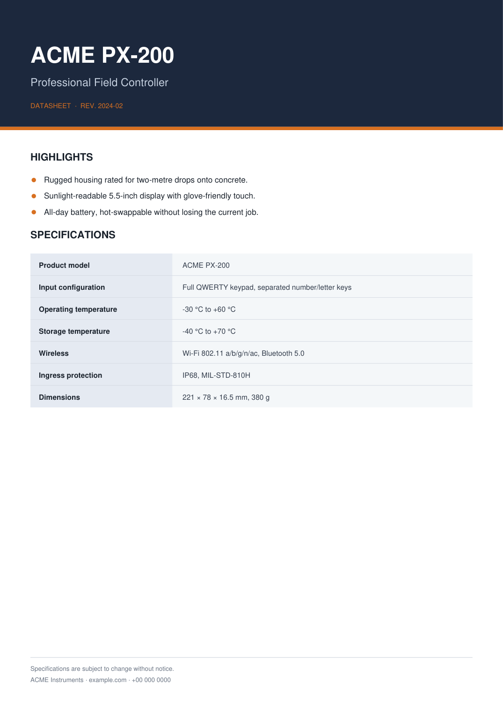
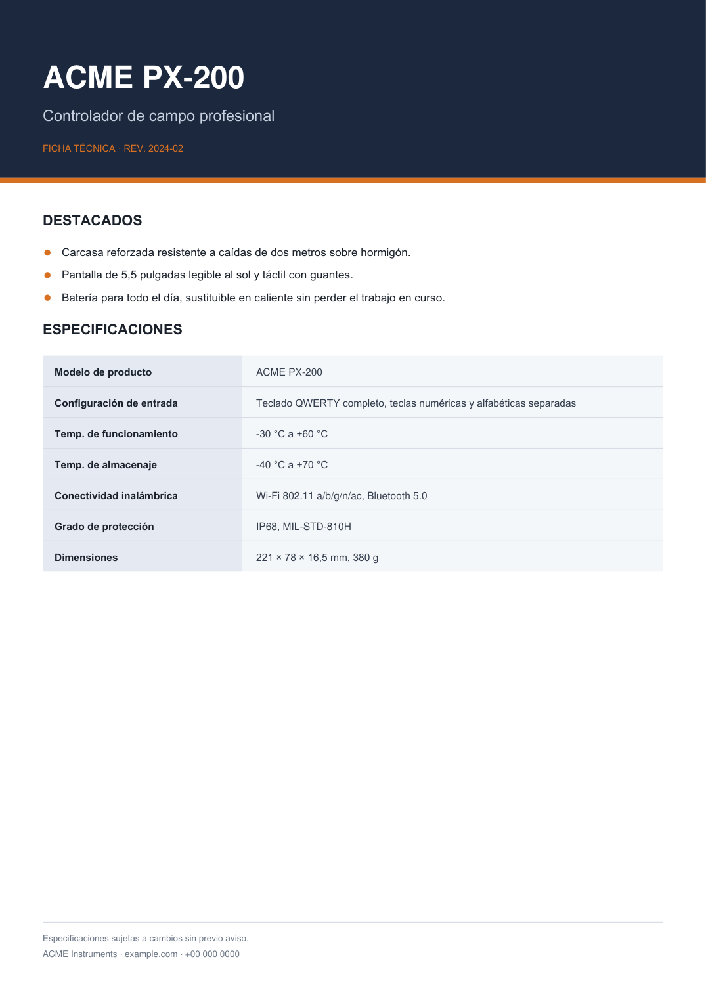

# pdf-inplace-translate

**保持原版式的 PDF 翻译工具。** 挖掉文字层，按原始基线坐标回填译文 —— 背景图、渐变、矢量表格、图标、二维码全部原样保留，因此版式不可能错乱。

[English](README.en.md) · [示例](examples/) · [实战案例](references/worked-example.md)

| 原文 (EN) | 译文 (ES) |
|---|---|
|  |  |

两页都是仓库内 `examples/make_demo.py` 生成的真跑结果。注意：整列填充底纹、表格横线、橙色圆点、头部色块全部原样，只有文字变了。

---

## 为什么要"原位替换"

把 PDF 转语言有两条路：

| 做法 | 结果 |
|---|---|
| 提取文字 → 翻译 → 重新排版成新 PDF | 原设计全丢：渐变没了、图标位置变了、表格合并单元格散了、二维码得重画 |
| **只替换文字层，图形一个都不动** | 版式 100% 一致，因为它根本就没被重排 |

本工具走第二条路。核心就三件事：

1. **精确挖字** —— `add_redact_annot(fill=None)` + `apply_redactions(images=IMAGE_NONE, graphics=LINE_ART_NONE, text=TEXT_REMOVE)`。只删文字对象，底图和矢量线一根不动。
2. **原基线回填** —— 坐标取自 `get_text("rawdict")` 的 `span["origin"]`（基线，不是 bbox 顶端），用 `TextWriter` 写回，字重、字号、颜色、对齐全部继承。
3. **自动容错** —— 目标语言通常比原文长 15~25%。脚本按推断出的格子宽度换行，行数超限就按 2% 步长缩字号，仍放不下会在终端报出来。

## 安装

```bash
git clone https://github.com/<你的用户名>/pdf-inplace-translate.git
cd pdf-inplace-translate
pip install -r requirements.txt     # 只有 pymupdf
```

需要一个系统字体（Arial / Calibri / Verdana 或它们的自由替代 Carlito、Liberation Sans、DejaVu Sans）。脚本会按 `arial → LiberationSans → DejaVuSans` 自动回落，所以 Linux 容器里也能跑。

## 30 秒试一下

仓库自带一个样例文档和一版已填好的西语 spec，无需准备素材：

```bash
python examples/make_demo.py examples/demo_datasheet.pdf          # 生成样例
python scripts/pdf_translate.py apply examples/demo.spec.json \
       -o /tmp/demo_es.pdf --title "Demo ES"                      # 直接回填
python scripts/pdf_translate.py verify examples/demo_datasheet.pdf /tmp/demo_es.pdf \
       --spec examples/demo.spec.json                             # 自检
python scripts/pdf_translate.py render /tmp/demo_es.pdf -d png/   # 出图目检
```

## 正常流程

### 1. 抽取

```bash
python scripts/pdf_translate.py extract 原文.pdf -o spec.json --lang es
```

每个文本块输出：

```json
{
  "id": "p2_b14",
  "src": "Operating temperature",
  "baselines": [352.1],
  "bbox": [116.7, 342.9, 205.2, 355.1],
  "x0": 116.7,
  "align": "left",
  "cx": null,
  "cell": [115.6, 214.5],
  "font": "calibri",
  "size": 9.0,
  "color": "#231f20",
  "maxw": 92.0,
  "max_lines": 1,
  "tgt": null
}
```

抽取时脚本做了几件你没空做的手工活：

- **同格多行合并**：行距 < 1.22×字号、且左起点 / 字体 / 字号一致 → 视为同一段
- **格子边界推断**：从矢量填充块的左右沿、细竖线的位置反推，带 y 轴重叠判断，避免把隔行的线当成边界
- **对齐判定**：同一列（同边界 + 同字体 + 同字号）里各块左起点参差 → `center` 并给出 `cx`；整齐一致 → `left`
- **可用宽度**：`maxw = 格子右边沿 − 文字起点 − 内边距`

### 2. 翻译并填 JSON

只改这几个字段，其余别动：

| 字段 | 说明 |
|---|---|
| `tgt` | 译文。`null` = 保留原文（型号、IP68 这类不译的留 null） |
| `drop` | `true` = 只删不写，用于把多块并成一处 |
| `max_lines` | 允许行数，默认 = 原文行数；合并单元格有余量时可调大 |
| `valign` | `"center"` = 按原文本垂直中心重排，一行变两行时不会偏上 |

批量填可以用 `--map`：

```bash
python scripts/pdf_translate.py extract 原文.pdf -o spec.json --lang de \
       --map glossary.json      # {"Operating temperature": "Betriebstemperatur", ...}
```

### 3. 回填

```bash
python scripts/pdf_translate.py apply spec.json -o 输出.pdf --title "文件名-DE"
```

### 4. 自检 + 目检

```bash
python scripts/pdf_translate.py verify 原文.pdf 输出.pdf --spec spec.json
python scripts/pdf_translate.py render 输出.pdf -d png/ --dpi 150
```

`verify` 检查三件事：原文残留、文字越界、文字重叠。

```
页数 1/1   尺寸 (595.3, 841.9) / (595.3, 841.9)
  原文残留：无
  未翻译（保留原文）5 块: ['p1_b01', 'p1_b10', 'p1_b18', 'p1_b20', 'p1_b24']
校验通过：无残留、无越界、无重叠
```

> **`verify` 全绿也要看图。** 它检测不到"文字压到图标上"——图形不是文字，没有 bbox 可比。

## 命令行

| 子命令 | 作用 | 关键参数 |
|---|---|---|
| `extract` | PDF → spec.json | `-o` 输出、`--lang` 语言标记、`--map` 术语表预填、`--pad` 格内留白、`--merge-gap` 合并阈值 |
| `apply` | spec.json → PDF | `-o` 输出、`--title` 写入 PDF 标题元数据 |
| `verify` | 自检 | `--spec` 用于检查原文残留 |
| `render` | PDF → PNG | `-d` 输出目录、`--dpi`、`--prefix` |

`--min-scale`（默认 0.84）控制字号最多缩到原尺寸的 84%；`--line-factor`（默认 1.2）是行距兜底倍数。

## 翻译质量守则

1. **目标语言更长**，表格行高固定，`max_lines` 通常加不了。**优先精简措辞**，不要靠缩字号硬塞。
2. **单行单元格不能变两行**。超长标签用行业通用缩写：`Operating temperature` → `Temp. de funcionamiento`。
3. **数字与符号本地化**：西/法/德用小数逗号（`5,5"`、`16,5 mm`）；温度写 `°C` 而非 `℃`（很多字体缺 U+2103 字形）。
4. **技术串保持原样**：频段号、`MIL-STD-810H`、`IP68`、`IEEE 802.11 a/b/g/n/ac`、型号、URL、电话、邮箱。
5. **品牌标识不译**：Logo 旁的 tagline、屏幕里的品牌字通常是矢量或位图，属品牌资产。
6. **大小写按目标语言习惯**：西语标题只首词大写；原稿全大写版式则保持全大写。
7. **`maxw` 是参考值**。若标题右侧有图标而脚本没识别到边界，手工改小，否则译文会压上去。

## 已知陷阱

- **不要用 `page.insert_text(fontname=...)`** 配合外部字体，会抛 `need font file or buffer`。用 `fitz.TextWriter` + `fitz.Font(fontfile=...)`（脚本已封装）。
- **删字必须带三个参数** `images=PDF_REDACT_IMAGE_NONE` / `graphics=PDF_REDACT_LINE_ART_NONE` / `text=PDF_REDACT_TEXT_REMOVE`，且 `fill=None`。否则会把背景图、表格线一起挖白。
- **原文字体常有连字替换**（`ti`→`Ɵ`、`fi`→`fi`），靠字符串匹配定位会失败，一律按 bbox 操作。
- **基线坐标**取自 `span["origin"]`，不是 bbox 顶端。
- **`doc.subset_fonts()` 必须在 `save()` 之前**，否则文件会因整字体内嵌而暴涨。
- 文本里出现 `U+2010` 连字符（复制出来是 `‐`）是 PyMuPDF 反查问题，渲染完全一致。

## 当作 Agent Skill 用

`SKILL.md` 是一份可直接投喂给 AI Agent 的技能说明（WorkBuddy / Claude Skills 格式）。放进 `~/.workbuddy/skills/` 或项目的 `.workbuddy/skills/` 后，说一句「把这个 PDF 翻成德语，版式别乱」即可自动走完四步。

## 限制

- **扫描版 PDF 不支持** —— 没有文字层，需要先 OCR。
- **文字溢出到图形上的情况需要人工判断** —— 脚本无法知道"这里有个图标"。
- **表格行高极紧（< 1.2×字号）时**，长译文只能缩字号，可能小到不美观；此时建议改原文措辞。
- **不处理阅读顺序 / Tag 结构** —— 适合印刷品、说明书、宣传页，不适合需要无障碍阅读的文档。

## 使用须知

只在你拥有修改权的文档上使用。翻译他人作品并分发涉及版权与商标，请自行确认授权范围。

## License

MIT
